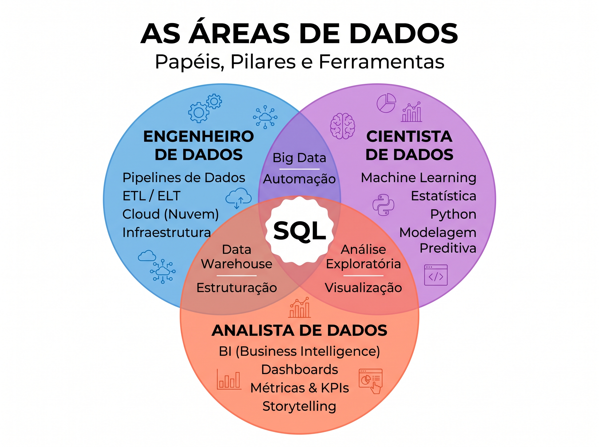

## Introdução

### 1. Profissionais de Dados

* **Engenheiro de Dados:** Responsável por projetar, construir e manter a infraestrutura e os fluxos (*pipelines*) que coletam, armazenam e transformam grandes volumes de dados para que fiquem confiáveis e prontos para análise, inteligência artificial e tomada de decisões.
* **Cientista de Dados:** Responsável por explorar, analisar e modelar grandes volumes de dados usando estatística, programação e *machine learning* para descobrir padrões, prever cenários e orientar decisões de negócio.
* **Analista de Dados:** Responsável por coletar, organizar, interpretar e visualizar dados históricos e atuais para responder a perguntas de negócio, acompanhar indicadores e apoiar decisões operacionais e estratégicas.



> **Independentemente da área, todos os profissionais utilizam SQL para armazenar, organizar e consultar dados.**

---

### 1.2 Banco de Dados

Para trabalhar com SQL, é essencial compreender como os dados são estruturados e gerenciados em camadas:

1. **SGBD (Sistema Gerenciador de Banco de Dados)**
   * É o *software* responsável por gerenciar, controlar e viabilizar o acesso aos bancos de dados. Atua como intermediário entre o usuário (ou aplicação) e os arquivos físicos armazenados no disco, garantindo segurança, integridade, controle de concorrência e execução otimizada das consultas SQL.
   * **Exemplos:** SQLite, PostgreSQL, MySQL, Microsoft SQL Server e Oracle.

2. **Database (Banco de Dados)**
   * É o contêiner lógico ou coleção organizada de dados inter-relacionados armazenados eletronicamente. Um único SGBD pode hospedar vários *databases* distintos (por exemplo, vendas, RH e programa de fidelidade).

3. **Tabela (*Table*)**
   * É a estrutura fundamental dentro de um banco de dados relacional onde os dados são armazenados em formato de grade (linhas e colunas). Cada tabela representa uma entidade ou assunto específico do negócio (como `clientes`, `produtos` ou `transacoes`), e cada **coluna** define um atributo dessa entidade junto com seu tipo de dado.

4. **Registros (*Records* / Linhas / Tuplas)**
   * São as linhas horizontais dentro de uma tabela. Cada registro representa uma ocorrência individual e completa daquela entidade — um conjunto de valores preenchidos para cada coluna.

**Exemplo prático de estrutura (Tabela `clientes`):**

| id_cliente *(Coluna)* | nome *(Coluna)* | pontos *(Coluna)* | data_cadastro *(Coluna)* |
| :--- | :--- | :--- | :--- |
| `101` | Ana Silva | `450` | `2025-03-10` |
| `102` | Bruno Costa | `120` | `2025-04-22` |

---

### 1.3 SQL

**Linguagem de Consulta Estruturada (*Structured Query Language* — SQL)** é a linguagem de pesquisa declarativa padrão para bancos de dados relacionais. Por ser declarativa, o foco está em especificar **o que** se deseja obter dos dados, deixando que o SGBD decida a maneira mais eficiente de executar a busca.

---

### 1.4 Elementos do SQL

Uma instrução SQL é composta por diferentes blocos estruturais que trabalham em conjunto para manipular e consultar dados:

* **Comandos:** São as instruções principais da linguagem. Quando executados, resultam em efeitos persistentes sobre os dados e estruturas do banco, além de controlarem transações, conexões e sessões.
  * *Exemplos:* `SELECT`, `INSERT`, `UPDATE`, `DELETE`, `CREATE`, `DROP`.
* **Cláusulas:** São os componentes internos dos comandos que definem especificamente o que será processado, filtrado, agrupado ou entregue (algumas são obrigatórias e outras opcionais).
  * *Exemplos:* `FROM`, `WHERE`, `GROUP BY`, `HAVING`, `ORDER BY`.
* **Expressões:** São combinações de valores, colunas, operadores matemáticos ou funções que produzem um único valor ou uma condição lógica.
  * *Exemplos:* `pontos * 2`, `A > B`, `C BETWEEN 20 AND 100`.
* **Predicados:** São expressões condicionais específicas que podem ser avaliadas pela lógica booleana do SQL, retornando **Verdadeiro (`TRUE`)**, **Falso (`FALSE`)** ou **Desconhecido (`UNKNOWN` / `NULL`)**.
  * *Exemplos:* `pontos >= 500`, `status = 'Ativo'`, `email IS NOT NULL`.
* **Queries (Consultas):** São instruções completas que combinam comandos, cláusulas, expressões e predicados para retornar dados baseados em critérios específicos.
  * *Exemplo:*
    ```sql
    SELECT nome, pontos        -- Comando (SELECT) + Colunas
    FROM clientes              -- Cláusula (FROM)
    WHERE pontos >= 500;       -- Cláusula (WHERE) + Predicado (pontos >= 500)
    ```

---

### 1.5 Tipos de Dados (*Data Types*)

Cada coluna de uma tabela exige a definição de um **tipo de dado**. Isso garante a integridade das informações (evitando que um texto seja inserido em um campo de valor monetário, por exemplo), otimiza o espaço em disco e define quais operações matemáticas ou de texto podem ser aplicadas.

| Categoria | Tipos Comuns em SQL | Descrição | Exemplos |
| :--- | :--- | :--- | :--- |
| **Numéricos (Inteiros)** | `INT`, `INTEGER`, `BIGINT` | Números exatos sem casas decimais, usados para IDs e contagens. | `1`, `42`, `1500` |
| **Numéricos (Decimais)** | `DECIMAL(p,s)`, `NUMERIC`, `FLOAT`, `REAL` | Números com casas decimais, usados para valores financeiros, taxas e métricas. | `19.90`, `0.75`, `3.1415` |
| **Texto / Caracteres** | `CHAR(n)`, `VARCHAR(n)`, `TEXT` | Cadeias de caracteres (letras, números e símbolos) delimitadas por aspas simples `' '`. | `'Ana Silva'`, `'SP'`, `'cliente@email.com'` |
| **Data e Hora** | `DATE`, `TIME`, `DATETIME`, `TIMESTAMP` | Armazenam datas, horários ou ambos combinados (padrão ISO `AAAA-MM-DD`). | `'2026-11-24'`, `'14:30:00'` |
| **Booleanos (Lógicos)** | `BOOLEAN` | Representam valores lógicos de verdadeiro ou falso. | `TRUE` (`1`), `FALSE` (`0`) |

> **Nota sobre `NULL`:** O `NULL` não é um tipo de dado, mas um marcador especial que representa a **ausência de valor** (desconhecido ou não preenchido). Ele é diferente de `0` (zero) ou `''` (texto vazio).
>
> **Particularidade do SQLite:** Como utilizaremos o SQLite no curso, vale destacar que ele possui tipagem dinâmica baseada em classes de armazenamento (`INTEGER`, `REAL`, `TEXT`, `BLOB` e `NULL`). Datas, por exemplo, são comumente armazenadas como `TEXT` no formato `'YYYY-MM-DD HH:MM:SS'`.

---

### 1.6 Chaves Primárias e Referenciais

Em bancos de dados relacionais, as informações são divididas em várias tabelas para evitar repetição desnecessária de dados. As **chaves** são os mecanismos que identificam cada registro e conectam essas tabelas entre si.

#### 1. Chave Primária (*Primary Key* — `PK`)
* É uma coluna (ou conjunto de colunas, chamada de chave composta) que **identifica unicamente** cada registro (linha) dentro de uma tabela.
* **Regras obrigatórias:**
  * **Unicidade:** Não pode haver dois registros com o mesmo valor na chave primária.
  * **Não nula (`NOT NULL`):** Todo registro precisa obrigatoriamente ter uma chave primária preenchida.

#### 2. Chave Referencial / Estrangeira (*Foreign Key* — `FK`)
* É uma coluna em uma tabela que aponta para a **Chave Primária (`PK`)** de outra tabela, estabelecendo um relacionamento entre elas.
* **Características:**
  * Garante a **integridade referencial** (impede que seja registrada uma transação para um `id_cliente` que não existe na tabela `clientes`).
  * Diferente da `PK`, a `FK` **pode se repetir** (um mesmo cliente pode realizar várias transações).

#### Exemplo Prático de Relacionamento

**Tabela `clientes` (`id_cliente` é a `PK`):**

| `id_cliente` (`PK`) | `nome` | `email` |
| :--- | :--- | :--- |
| `101` | Ana Silva | `ana@email.com` |
| `102` | Bruno Costa | `bruno@email.com` |

**Tabela `transacoes` (`id_transacao` é a `PK` e `id_cliente` é a `FK`):**

| `id_transacao` (`PK`) | `id_cliente` (`FK`) | `data_transacao` | `pontos` |
| :--- | :--- | :--- | :--- |
| `9001` | `101` | `2026-11-20` | `+50` |
| `9002` | `101` | `2026-11-22` | `+120` |
| `9003` | `102` | `2026-11-24` | `+30` |

*(No exemplo acima, a chave estrangeira `id_cliente` na tabela `transacoes` permite cruzar os dados e descobrir que Ana Silva acumulou 170 pontos em duas transações distintas.)*